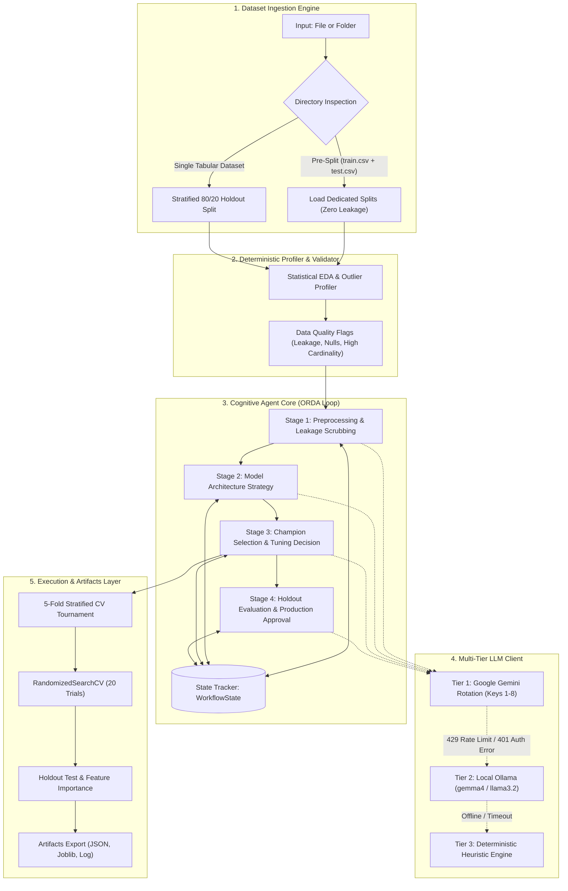

# ML Studio — Agent Architectural Specification & Capabilities

## 1. Executive Summary: Is the Agent Reactive?

In classical AI agent taxonomy (Russell & Norvig), agents are classified along a spectrum:
1. **Simple Reflex / Pure Reactive Agents**: Select actions based *solely* on current percepts, ignoring history, lacking internal state, and unable to perform forward reasoning or hypothesis testing.
2. **Model-Based Stateful Agents**: Maintain an explicit internal model of the world and their own trajectory over time.
3. **Goal-Based Deliberative / Cognitive Agents**: Combine internal state representation with reasoning loops (Observe-Reason-Decide-Act) to hypothesize, optimize, and justify multi-step actions.

### Architectural Classification
> **ML Studio’s agent is NOT a simple reactive agent.**  
> It is an **Autonomous Stateful Deliberative Cognitive Agent** operating in an **Observe-Reason-Decide-Act (ORDA)** loop.

While it perceives environment signals (such as IQR outlier counts, cardinality metrics, cross-validation variance, and holdout scores), its decisions are:
* **State-conditioned**: Each stage reads from and mutates an explicit `WorkflowState` containing the full history of prior observations, data quality flags, and baseline tournament outcomes.
* **Hypothesis-driven**: The agent formulates theoretical machine learning hypotheses regarding data geometry, bias-variance trade-offs, and residual loss minimization.
* **Goal-directed**: It optimizes a designated objective function (e.g., F1-macro, ROC-AUC, RMSE) while balancing cross-validation stability ($\sigma_{\text{CV}}$) against raw mean performance ($\mu_{\text{CV}}$).

---

## 2. High-Level System Architecture Diagram



---

## 3. Core Architectural Subsystems

### 3.1 Dataset Ingestion & Pre-Split Detection Engine
The dataset ingestion layer (`src/data/loader.py`) handles both individual tabular files and directory packages:
* **Directory Inspection**: Recursively scans an uploaded folder for `.csv`, `.xlsx`, or `.xls` files.
* **Pre-Split Detection**: Scans filename stems for `*train*` and `*test*`/`*val*`. If found:
  * Uses dedicated training and test partitions directly, preventing any artificial resplitting or holdout contamination.
* **Single Dataset Fallback**: If a single file or a directory with one primary dataset is provided, the agent applies an automated 80/20 Stratified Holdout train/test split.

### 3.2 The Stateful Cognitive Loop (Observe-Reason-Decide-Act)
The agent operates through four sequential deliberation milestones tracked in `src/agent/state.py`:

```text
[OBSERVE]  Inspect column types, null distributions, IQR outlier counts, and constant columns.
    │
[REASON]   Formulate theoretical hypothesis (e.g. RobustScaler for IQR outliers; One-Hot vs Ordinal to prevent tree sparsity).
    │
[DECIDE]   Output structured JSON specifying target, metric, imputation, scaling, and dropped identifiers.
    │
[ACT]      Execute scikit-learn ColumnTransformer and record state transition.
```

#### The 4 Deliberation Milestones:
1. **EDA & Preprocessing Milestone**:
   * Evaluates cardinality and identifier risks (`customer_id`, `UUID`, timestamps).
   * Chooses between `RobustScaler` (if IQR outliers exist) and `StandardScaler` / `MinMaxScaler`.
   * Enforces `OneHotEncoder` for low cardinality or `OrdinalEncoder` for high cardinality.
   * Activates `use_class_weights` if target class distribution exhibits imbalance.
2. **Model Architecture Strategy Milestone**:
   * Analyzes feature space dimensionality ($D$) versus training samples ($N$).
   * Curates a balanced candidate suite spanning **Decision Trees**, **Bagging** (Random Forest), **Boosting** (Gradient Boosting), **Kernel Methods** (SVM with RBF kernels), and **Meta-Ensembles** (Soft Voting & Stacking Generalization).
3. **Tournament Champion Selection & Tuning Milestone**:
   * Evaluates cross-validation fold distributions.
   * Compares baseline mean scores against fold standard deviations ($\sigma$) to detect unstable or overfitted architectures.
   * Selects the single most promising champion model and initiates `RandomizedSearchCV` hyperparameter tuning (e.g., 20 trials exploring learning rate, tree depth, estimators, and subsampling).
4. **Holdout Evaluation & Production Milestone**:
   * Evaluates the fitted champion estimator on the untouched 20% holdout split.
   * Computes holdout Accuracy, F1-macro, Precision, Recall, ROC-AUC, and Confusion Matrix.
   * Extracts Gini-based feature importances or linear coefficients.
   * Generates production readiness rationale.

---

## 4. Multi-Tier Resilient Inference Architecture

The agent implements a zero-downtime, 3-tier fallback architecture (`src/agent/agent.py`):

| Tier | Provider | Engine / Models | Self-Healing Capability |
|---|---|---|---|
| **Tier 1** | Google Gemini Cloud | `gemini-2.5-flash` / `gemini-1.5-flash` | Automated round-robin rotation across multiple API keys (`GEMINI_API_KEY1` ... `GEMINI_API_KEY8`). Automatically switches keys on `429` (rate limits) or `401` (auth errors). |
| **Tier 2** | Local Ollama Host | `gemma4:e4b` (major tasks) / `llama3.2:3b` (minor tasks) | Local private LLM server (`http://localhost:11434`) used automatically if cloud access is offline or keys are exhausted. |
| **Tier 3** | Deterministic Heuristic | Algorithmic Rule Engine | Built-in statistical rules (IQR IQR detection, variance thresholding, margin rankers) ensuring 100% pipeline reliability without LLM connectivity. |

---

## 5. State Representation Schema (`WorkflowState`)

The agent’s memory is persisted in `outputs/experiments/experiment_history.json`:

```json
{
  "dataset": {
    "rows": 100,
    "columns": 7,
    "numerical_features_count": 4,
    "categorical_features_count": 3,
    "missing_percentage": 0.57
  },
  "problem": {
    "target": "churn",
    "task": "binary_classification"
  },
  "data_quality": {
    "warnings": [
      "Column 'customer_id' has high cardinality (100 unique values). Likely identifier.",
      "Column 'status_code' is constant (contains only 1 unique value)."
    ]
  },
  "preprocessing": {
    "exclude_columns": ["customer_id", "status_code"],
    "numerical_imputation": "median",
    "scaling": "standard",
    "categorical_encoding": "one_hot",
    "use_class_weights": true
  },
  "experiments": [
    {
      "stage": "baseline",
      "model": "Gradient Boosting (Boosting)",
      "metrics": { "accuracy": 0.825, "f1": 0.4511, "roc_auc": 0.6738 },
      "cv_mean": 0.4511,
      "cv_std": 0.0230,
      "runtime_seconds": 0.26
    }
  ],
  "agent_history": [
    {
      "stage": "ANALYZED",
      "action": "preprocess_data",
      "decision": {
        "observation": "...",
        "decision": "...",
        "confidence": 0.95,
        "reason": "..."
      }
    }
  ]
}
```

---

## 6. Model Zoo & Tournament Capabilities

* **Linear Baselines**: Logistic Regression (with class weights), Ridge Regression.
* **Interpretable Trees**: Scikit-Learn DecisionTreeClassifier / Regressor.
* **Bagging (Bootstrap Aggregation)**: RandomForestClassifier / Regressor with parallel feature subsampling.
* **Boosting (Residual Loss Optimization)**: GradientBoostingClassifier / Regressor.
* **Kernel Methods**: Support Vector Machines (SVC / SVR) with Radial Basis Function (`RBF`) and Linear kernels.
* **Voting Ensembles**: Soft-voting meta-classifier averaging predicted class probability distributions.
* **Stacking Ensembles**: Stacked generalization with out-of-fold cross-validation predictions fed to a meta-learner.

---

## 7. Auditable Deliverables & Production Artifacts

Upon workflow completion, ML Studio exports 5 production artifacts into `outputs/`:
1. `outputs/reports/final_report.json`: Machine-readable executive report with confusion matrix and holdout metrics.
2. `outputs/reports/final_report.txt`: Human-readable formatted deployment summary.
3. `outputs/experiments/experiment_history.json`: Complete audit trace of all baseline tournament runs, std dev figures, and agent state transitions.
4. `outputs/models/best_model.joblib`: Fully fitted, serialized Scikit-Learn estimator ready for low-latency batch or real-time inference.
5. `outputs/logs/workflow.log`: Timestamped line-by-line execution trace documenting LLM calls, key rotations, and validation timings.
